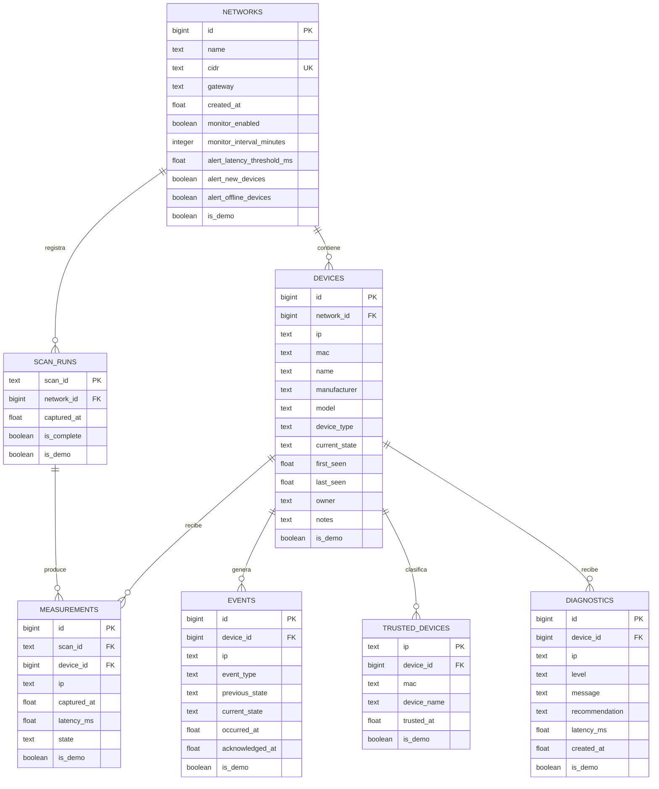

# GearEye: modelo entidad–relación

El esquema PostgreSQL contiene siete tablas. Los campos `is_demo` permiten identificar los datos académicos sintéticos, que no aparecen en el inventario real de la aplicación.

## Vistas materializadas

- `mv_device_performance`: mediciones, cantidad de respuestas y latencias media, mínima y máxima por dirección IP.
- `mv_network_daily_summary`: escaneos completos, equipos y latencia media por red y día.

GearEye las refresca después de guardar cada escaneo en PostgreSQL. PostgreSQL conserva el resultado materializado y lo vuelve a calcular con `REFRESH MATERIALIZED VIEW` cuando se solicita; la aplicación realiza esa actualización automáticamente al terminar cada escaneo.

El archivo [`../Database/modelo_geareye_postgresql.sql`](../Database/modelo_geareye_postgresql.sql) contiene el esquema ejecutable. [`../Database/seed_demo_postgresql.sql`](../Database/seed_demo_postgresql.sql) genera 100 filas sintéticas por tabla, y [`../Database/verificar_requisitos.sql`](../Database/verificar_requisitos.sql) comprueba las cantidades y las vistas.
