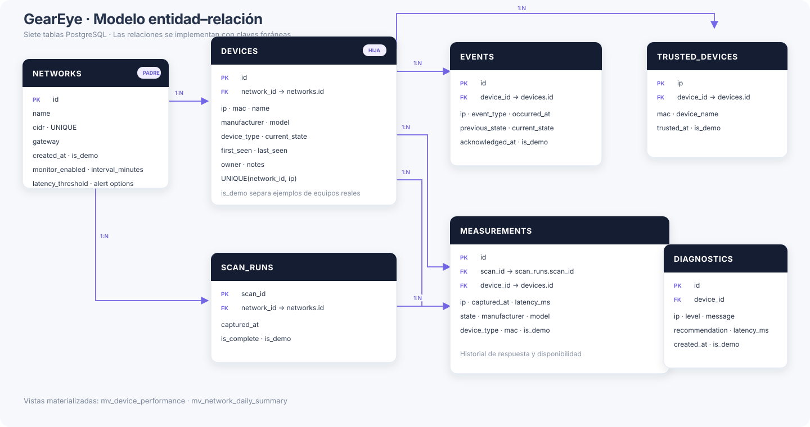
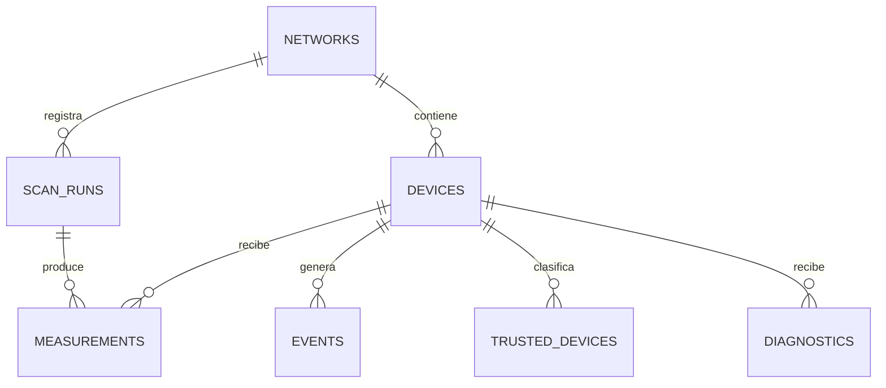

# GearEye · Modelo entidad–relación

> **Persistencia de red en PostgreSQL**
> Estructura para inventario, escaneos, mediciones, eventos, confianza y diagnósticos.

  

## Resumen del esquema

| Elemento | Diseño |
|:--|:--|
| Tablas | **7** |
| Vistas materializadas | **2** |
| Relaciones principales | Red → dispositivos y escaneos → mediciones |
| Datos de demostración | Separados mediante `is_demo` |
| Retención operativa | Hasta **180 días** para mediciones y eventos |

Los registros académicos sintéticos están separados del inventario real con el campo `is_demo`. Las direcciones de demostración pertenecen a rangos reservados y no representan equipos ni tráfico reales.

## Cómo se relacionan los datos

Una red agrupa los dispositivos descubiertos y las ejecuciones de escaneo. Cada ejecución produce mediciones. Los eventos registran cambios observados, la lista de confianza conserva las decisiones del operador y los diagnósticos almacenan resultados de análisis por equipo.

## Tablas

<strong>01 · networks</strong> — redes y configuración de monitoreo

Identifica cada subred mediante su CIDR y almacena puerta de enlace, estado del monitoreo, intervalo y umbrales de alerta.

**Clave:** `id` · **Identificador único:** `cidr`

<strong>02 · devices</strong> — inventario persistente de equipos

Conserva IP, MAC, nombre, fabricantes, modelo, tipo, estado y fechas de primera y última detección. Incluye los campos operativos `owner` y `notes`.

**Claves:** `id` · `network_id` → `networks.id` · **Unicidad:** red + IP

<strong>03 · scan_runs</strong> — ejecuciones de escaneo

Registra cuándo se realizó un escaneo, a qué red pertenece y si se completó. `scan_id` identifica cada ejecución.

**Clave:** `scan_id` · `network_id` → `networks.id`

<strong>04 · measurements</strong> — observaciones por dispositivo y escaneo

Guarda estado, latencia y atributos observados en cada escaneo; permite construir el historial de disponibilidad y rendimiento.

**Claves:** `id` · `scan_id` → `scan_runs.scan_id` · `device_id` → `devices.id`

<strong>05 · events</strong> — cambios y alertas de red

Almacena nuevas detecciones, cambios de estado, ausencias y latencias elevadas, con marcas de tiempo y reconocimiento del operador.

**Clave:** `id` · `device_id` → `devices.id`

<strong>06 · trusted_devices</strong> — equipos aprobados por el operador

Relaciona la IP y MAC reconocidas con el equipo correspondiente y la fecha en que se marcó como confiable.

**Clave:** `ip` · `device_id` → `devices.id`

<strong>07 · diagnostics</strong> — resultados de diagnóstico

Conserva nivel, mensaje, recomendación, latencia, observaciones y fecha del diagnóstico asociado a una IP.

**Clave:** `id` · `device_id` → `devices.id`

## Vistas materializadas

| Vista | Contenido | Actualización |
|:--|:--|:--|
| `mv_device_performance` | Cantidad de mediciones, respuestas y latencias media, mínima y máxima por IP. | Después de guardar un escaneo en PostgreSQL. |
| `mv_network_daily_summary` | Escaneos completos, dispositivos y latencia media por red y día. | Después de guardar un escaneo en PostgreSQL. |

PostgreSQL almacena los resultados de las consultas y GearEye los renueva con `REFRESH MATERIALIZED VIEW` al guardar un escaneo.

## Archivos del modelo

- [Esquema PostgreSQL](../Database/modelo_geareye_postgresql.sql) — crea las siete tablas y las vistas materializadas.
- [Datos de demostración](../Database/seed_demo_postgresql.sql) — genera 100 filas sintéticas por tabla, identificadas con `is_demo = TRUE`.
- [Verificación de requisitos](../Database/verificar_requisitos.sql) — consulta tablas, registros de demostración y vistas.

> **Alcance de los datos:** el historial refleja lo que GearEye detectó durante sus escaneos. No representa una captura continua de todo el tráfico ni identifica a la persona que utilizó un dispositivo.
